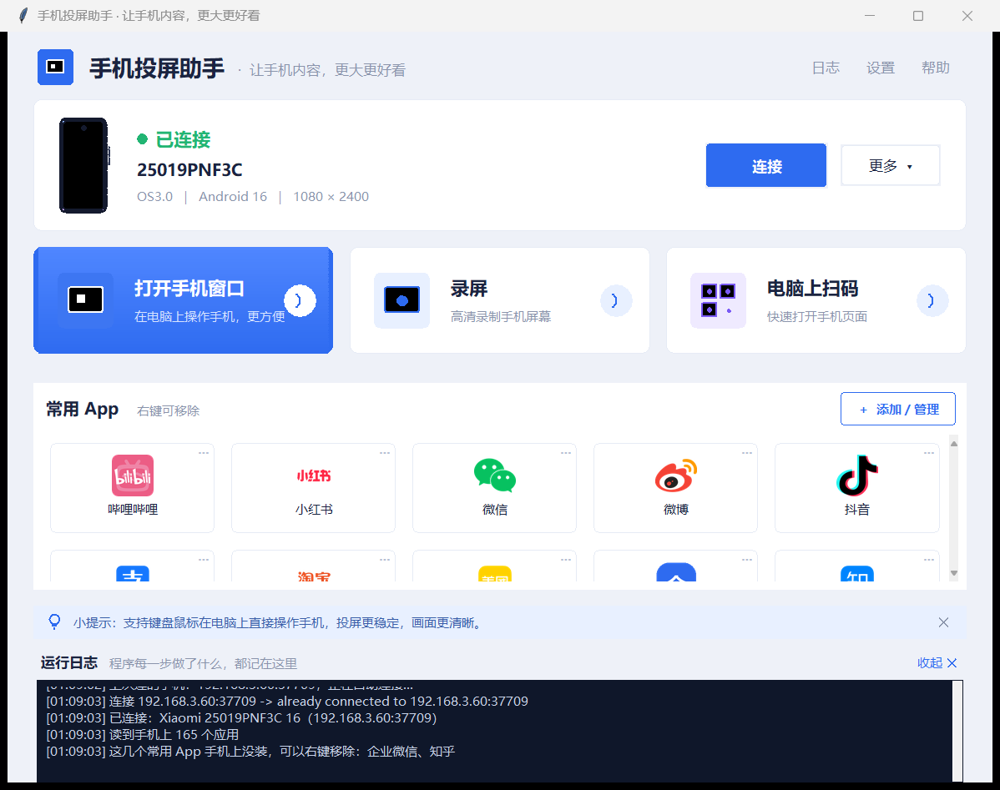

# PhoneMirror · 手机投屏助手

> 在 Windows 电脑上无线操控安卓手机：看画面、点、拖、打字、录高清屏、常用 App 单独开窗口。
> 全程不用数据线，双击就能启动。



## 它能做什么

| 功能 | 说明 |
| --- | --- |
| 无线连接 | 首次扫码式配对（输入配对码），之后自动在局域网里发现手机并连接 |
| 实时操控 | 鼠标点击 / 拖动 / 滚轮，键盘直接打字，延迟低 |
| 中文输入 | 用 UHID 模拟物理键盘，手机上**不会弹出软键盘**挡住输入框 |
| App 独立窗口 | 常用 App 各开一个窗口，像电脑软件一样排布使用 |
| 常用 App 快捷入口 | 从手机已装应用里挑，图标网格，右键可移除 |
| 电脑上扫码 | 电脑上看到二维码，拖个框框住就发给手机相册，用 App 的扫一扫选相册即可 |
| 高清录屏 | 整屏或单个 App 窗口，MP4 直接存电脑，可进剪映剪辑 |
| 每个窗口独立工具栏 | 窗口右侧悬浮栏：截图 / 录屏 / 置顶 / 关闭，跟着窗口走 |
| 剪贴板互通 | 开着手机窗口时，电脑复制 → 手机粘贴，反之亦然 |

## 快速开始

### 1. 手机端准备（只做一次）

1. **设置 → 我的设备 → 全部参数**，连点「MIUI 版本」7 次，打开开发者选项
2. **设置 → 更多设置 → 开发者选项**，打开这三个：
   - USB 调试
   - **USB 调试（安全设置）** ← 不开这个鼠标点不动
   - 无线调试
3. 打开「无线调试」→「使用配对码配对」，会显示 `IP:端口` 和 6 位配对码
4. 改完**重启一次手机**（小米必须）

### 2. 电脑上

- 下载本仓库，双击 `启动手机助手.vbs`（或 `手机助手.bat`）
- 点右上角【设置】→【配对手机】，填入手机上的 `IP:端口` 和配对码
- 连上后点【打开手机窗口】就开始用

> 需要 Windows 10/11 + Python 3.9 以上（自带 tkinter）。
> 仓库里已带好 scrcpy 5.0.1 和 adb，不需要另外装。

## 界面

- 顶部两块（设备卡片、三张功能大卡）和【常用 App】模块**固定不动**
- 只有常用 App 的**图标网格**和运行**日志**自己带滚动条
- 右上角是【日志 / 设置 / 帮助】三个文字链接

## 目录结构

```
phone_mirror.py    主程序（界面 + 业务逻辑）
pm_tools.py        底层：adb/scrcpy 调用、截图、窗口管理、DPI 处理
ui_kit.py          纯 tkinter 自绘的 UI 组件库（卡片/按钮/磁贴/滚动容器）
icons/             常用 App 的真实品牌图标
vendor/scrcpy/     scrcpy 5.0.1 + adb 官方 Windows 发行版
docs/              文档与截图
使用说明.md         详细中文使用说明
```

## 实现要点

- **配对**：scrcpy v5 起移除了 `--pair`，配对走 `adb pair <ip:port> <code>`；日常重连用 `adb mdns services` 发现 `_adb-tls-connect._tcp` 后 `adb connect`（端口每次随机，所以不能写死）
- **中文输入**：`--keyboard=uhid`，让手机认为接了物理键盘，软键盘不弹出。局限是电脑端输入法的候选框不会跟着过去，实际用法是**电脑敲拼音 + 手机端候选条选字**
- **录制**：录屏时另起一个小 scrcpy 实例（同一个虚拟屏 `--display-id`），这样原来那个窗口不用关掉重开。录制窗口**必须可见**，隐藏或最小化会录出 0 字节，所以做法是缩小放到右下角
- **截图**：`PrintWindow(PW_RENDERFULLCONTENT)` 直接抓窗口内容，不用把窗口提到前台，被别的窗口挡住也能截
- **DPI**：系统缩放非 100% 时 `GetWindowRect` 返回虚拟坐标会导致截图偏移，程序启动第一件事就是 `SetProcessDpiAwareness(2)`

## 已知限制

- 电脑输入法的候选字没法直接进手机（UHID 限制），需要看手机上的候选条选字
- 没法自动跳转进 App 的扫一扫界面（微信/支付宝都没暴露可用入口），扫码流程是「框选 → 推到相册 → App 里扫一扫选相册」
- 小米机型必须开「USB 调试（安全设置）」并重启，否则鼠标点击无效

## 许可证

- 本项目代码：MIT，见 [LICENSE](LICENSE)
- `vendor/scrcpy/` 为 [scrcpy](https://github.com/Genymobile/scrcpy) 官方发行版，遵循其自带 Apache-2.0 许可
- `icons/` 中的应用图标归各自品牌所有，仅用于标识对应应用
